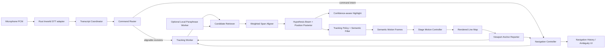

# CandidCue Intelligent Alignment, Navigation, and Scroll Control

## Alignment Engine v3 — implementation specification

**Project:** CandidCue  
**Status:** Proposed implementation specification  
**Scope:** Transcript reconciliation, fuzzy alignment, paraphrase recovery, discontinuous navigation, spoken commands, manual scrolling, current-word display, diagnostics, tests, and rollout  
**Primary platform:** Tauri 2 desktop application on macOS  
**Primary language:** English in the first release, with explicit seams for other languages

---

## 0. Executive decision

CandidCue should **not** replace its current tracker with an LLM and should **not** discard the existing alignment architecture. The supplied snapshot already contains a serious deterministic foundation:

- transcript normalization;
- exact, alias, numeric, contraction, edit-distance, and phonetic token matching;
- weighted local sequence alignment;
- indexed candidate-window retrieval;
- a multi-hypothesis beam;
- section-boundary controls;
- retake persistence;
- continuous semantic-position filtering;
- jerk-limited stage movement.

The update should therefore be implemented as **Alignment Engine v3**, an evolution of the existing engine rather than a rewrite.

The central architectural change is this:

> Stop treating the transcript as one authoritative string and the current location as one authoritative token. Treat the transcript as a revisioned, uncertain sequence; align bounded token spans rather than isolated words; maintain a probability distribution over plausible script positions; and keep the script position separate from the viewport position.

The v3 system has six major additions:

1. **Revision-safe transcript ingestion** that retracts and replaces provisional suffixes correctly.
2. **Weighted span alignment** supporting fuzzy words, phonetic errors, missed words, extra words, contractions, numbers, and one-to-many or many-to-one matches.
3. **Position posterior and explicit reacquisition modes** rather than a single best local match.
4. **Optional local semantic retrieval** for paraphrases and natural-language navigation, used only to nominate script regions—not to decide the exact current word.
5. **A real command router** that masks command speech from the reading aligner and resolves spoken navigation safely.
6. **Semantic viewport controls** so scrolling, “return to current word,” and “continue from here” operate on token positions rather than raw pixels.

The safety rule remains:

> When evidence is weak, freeze rather than guess. A wrong hold is recoverable; a confident-looking jump to unrelated text is not.

---

## 1. Current implementation audit

### 1.1 What is already working conceptually

The current path is connected end to end:

1. The renderer captures microphone audio.
2. Rust maintains the Inworld WebSocket and emits transcript frames.
3. `voice-session.ts` maps each STT frame into a tracking event.
4. The control-side ledger reconciles transcript items.
5. Every partial and final event is forwarded to the tracking worker.
6. The worker owns an `AlignmentEngine` and emits tracking snapshots and semantic motion frames.
7. The stage converts semantic position into rendered scroll motion.
8. `InlineNodes.svelte` marks every rendered word with `data-t="<tokenIndex>"` and underlines the current token.

The user-visible limitation is therefore not a disconnected STT path. It is the quality and authority model inside and around alignment.

### 1.2 Concrete weaknesses in the supplied snapshot

| Area | Current behavior | Limitation | Required v3 change |
|---|---|---|---|
| Provisional STT | Keeps the longer of the existing and incoming partial strings | A provider correction that becomes shorter cannot retract stale text | Replacement-revision ledger with mutable suffixes |
| Token matching | One transcript token is scored against one script token | Cannot naturally align `cannot` ↔ `can not`, `42` ↔ `forty two`, split names, merged words, or phrase substitutions | Bounded span matcher with 1↔1, 1↔2, 2↔1, and selected 1↔3 / 3↔1 transitions |
| Edit matching | Bounded character Levenshtein on sufficiently long words | Useful for spelling-like errors but weak for actual acoustic confusions | Combine normalized edit similarity, phonetic similarity, aliases, ASR confidence, and learned speaker-specific confusions |
| Phonetics | Hand-rolled English-oriented key | Useful but incomplete for names, accents, and multiword variants | Pluggable language profile and stronger phonetic encoder |
| Sequence alignment | Smith–Waterman-flavored local DP with linear insertion/deletion costs | Long omissions and ad-libs are costed poorly; the best cell may end before the newest transcript words | Tail-constrained semi-global alignment with affine gaps and top-k endpoints |
| Candidate search | Strong local, rare-token, alias, phonetic, fidelity, and n-gram windows | No character n-gram retrieval; no clause/sentence semantic retrieval; arbitrary distant reacquisition remains difficult | Add char-gram, viewport, phrase-span, and optional semantic candidate sources |
| “Same meaning” speech | No actual sentence-meaning model in the live path | A genuine paraphrase may look like unrelated substitutions | Optional local sentence/clause embedding retriever, never sole cursor authority |
| Retake phrases | Exact normalized substring checks | “Let’s do that once more” or an STT-corrupted command may not be detected | Fuzzy intent grammar plus destination evidence |
| Spoken commands | Protocol seams exist, but no live command channel is wired in the snapshot | Command masking, pending state, and command moves are unused | Command router and transcript arbitration lifecycle |
| Manual wheel scrolling | Stage applies pixels locally and sends only `deltaPx`; control ignores it | Tracker does not know what text is visible | Stage reports a semantic viewport anchor derived from its line map |
| “Re-find me here” | Re-seeds the engine with the engine’s existing cursor | It does not use the visible position | Reacquire around `viewportAnchor.centerTokenIndex` |
| Highlight | One exact token is underlined | It overstates certainty and jitters when the estimate is ambiguous | Confidence-aware peak and credible-range display |
| Inworld input | Sends model, encoding, sample rate, and language only | Script-specific names and terms are not used to bias recognition; returned word timestamps are discarded | Add tested custom vocabulary support and parse timestamps when available |
| Evaluation | Runtime diagnostics and a replay harness exist, but the uploaded snapshot omits the test corpus | Thresholds cannot be calibrated confidently from code alone | Ground-truthed replay corpus, corruption generator, safety gates, and shadow rollout |

### 1.3 Important integration defects to fix first

#### Defect A — provisional text cannot shrink

`ledger.ts` currently chooses whichever provisional string is longer. That is not a revision model. A recognizer often changes its hypothesis rather than merely appending to it. For example:

```text
Revision 1: "we should build a very complicated navigation system"
Revision 2: "we should build a complicated navigation system"
```

The second revision is more accurate but shorter. The current policy retains the stale word `very`.

#### Defect B — manual scroll has no semantic destination

The stage sends this:

```ts
{ kind: 'manual_scroll', deltaPx }
```

The control side deliberately performs no tracking action. Pixel delta is also insufficient: it has no stable meaning after a layout rebuild, font change, window resize, or different stage display.

#### Defect C — “Re-find me here” reuses the old cursor

The current implementation reads `snapshot.tokenIndex` and performs an authoritative move to the same token. It never asks the stage which token is actually visible.

#### Defect D — command infrastructure has no router

The worker supports masking, releasing, command-pending freezes, and authoritative command moves. The compiler also has command-related seams. The missing component is the control-side router that decides which transcript items are commands and which remain script speech.

---

## 2. Required product behavior

The finished system must satisfy the following user scenarios.

### 2.1 Ordinary reading with STT errors

Script:

> We need a genuinely intelligent alignment system.

Transcript:

> We need a generally intelligent alignment system.

Expected behavior:

- `generally` may match `genuinely` through phonetic and character evidence;
- the surrounding ordered words strengthen the match;
- the cursor continues smoothly;
- no warning or manual intervention is required.

### 2.2 Missing script words

Script:

> The update should remain local, deterministic, private, and extremely responsive.

Presenter says:

> The update should remain local, private, and responsive.

Expected behavior:

- the aligner treats `deterministic` and `extremely` as script gaps;
- one omission run is cheaper than two unrelated jumps;
- the cursor lands at `responsive` rather than stalling at `local`.

### 2.3 Extra speech and fillers

Script:

> This is the central design decision.

Presenter says:

> So, you know, this is really the central design decision.

Expected behavior:

- turn-initial and known filler phrases are cheap transcript insertions;
- `really` is a moderate ad-lib insertion;
- the script position remains stable.

### 2.4 Contraction and tokenization differences

Script:

> We cannot let it jump.

Transcript:

> We can’t let it jump.

Expected behavior:

- `cannot` and `can’t` align through a 1↔1 or 1↔2 normalized span equivalence;
- no manual alias is required.

### 2.5 Near paraphrase

Script:

> A false jump is more damaging than a brief pause.

Presenter says:

> Stopping for a moment is better than jumping to the wrong place.

Expected behavior:

- a local semantic retriever identifies the sentence or clause as a plausible region;
- because there is insufficient word-level evidence for an exact token, the tracker holds or displays a sentence-level uncertain range;
- the next lexical anchor reacquires the exact word;
- semantic similarity alone never causes a distant, exact-word jump.

### 2.6 Forward skip

The presenter skips two sentences and resumes at a distinctive phrase later in the same section.

Expected behavior:

- local and current-section candidates include the destination;
- strong final lexical evidence establishes a new leading hypothesis;
- the stage catches up or reanchors according to rendered distance;
- the move is recorded as a skip, not ordinary token-by-token advancement.

### 2.7 Backward retake

The presenter says:

> Let me try that last paragraph again.

Expected behavior:

- command/retake intent is recognized despite minor STT errors;
- the previous paragraph start is resolved structurally;
- command speech is excluded from script alignment;
- the destination is authoritative and a new semantic epoch begins.

### 2.8 Unannounced distant restart

The presenter stops, then begins reading a unique sentence from another section without a command.

Expected behavior:

- ordinary local following fails safely and enters global reacquisition;
- a distant candidate can be considered, but not immediately committed;
- the system waits for enough final, distinctive evidence and a clear margin over alternatives;
- while deciding, motion holds;
- once confirmed, it performs one explicit reanchor transition.

### 2.9 Manual peek and return

The operator scrolls upward to inspect earlier text but continues speaking from the original position.

Expected behavior:

- the viewport moves independently;
- automatic visual following pauses while the user is peeking;
- the semantic cursor continues to be estimated in the background;
- “Return to current word” moves the viewport back to the committed/estimated position;
- the semantic reading location is never changed merely because the wheel moved.

### 2.10 Manual scroll and continue from visible text

The operator scrolls to another paragraph and says:

> CandidCue, continue from here.

Expected behavior:

- the stage has already reported the visible semantic anchor;
- the command resolves `here` to that anchor;
- the navigation controller performs an authoritative manual/command reanchor;
- alignment restarts around that location and following resumes.

### 2.11 Natural-language document navigation

The presenter says:

> CandidCue, start from the section where I explain false jumps.

Expected behavior:

- the command router recognizes a navigation intent;
- the target resolver searches headings, sentences, clauses, and content summaries;
- exact/fuzzy heading matches outrank semantic matches;
- if one target is clearly best, the system moves there;
- if several targets are plausible, the control window shows choices and the stage does not jump.

---

## 3. Goals, non-goals, and invariants

### 3.1 Goals

1. Follow normal scripted reading with substitutions, insertions, deletions, fillers, and tokenization differences.
2. Reacquire after local skips, retakes, or distant starts.
3. Understand approximate phrase matches and limited paraphrases without surrendering deterministic cursor safety.
4. Support manual and spoken navigation throughout the document.
5. Keep the current-word display useful without claiming false precision.
6. Remain local, fast, bounded, debuggable, and reproducible.
7. Preserve smooth stage motion and structural boundary safety.
8. Produce a benchmarkable system whose thresholds are derived from replay data rather than intuition alone.

### 3.2 Non-goals

1. Generating or rewriting the script during a take.
2. Using a general-purpose cloud LLM to decide the cursor position.
3. Inferring exact word position from semantic similarity alone.
4. Automatically moving the semantic cursor whenever the operator scrolls.
5. Supporting unrestricted conversational understanding in the first release.
6. Making every language work through English stopword, contraction, and phonetic rules.
7. Replacing the existing motion controller.

### 3.3 Hard invariants

1. **Final evidence outranks provisional evidence.**
2. **Partial revisions may alter the estimated cursor but may not force the committed cursor backward.**
3. **A low-confidence update produces a hold, not a speculative move.**
4. **An exact/common-word match alone cannot authorize a distant jump.**
5. **Semantic similarity cannot by itself authorize an exact current word or cross-section jump.**
6. **Manual viewport movement and semantic reading position are separate states.**
7. **Command speech is never aligned as script speech once classified as a command.**
8. **A failed or timed-out command is released back to the reading ledger and reconsidered.**
9. **Every discontinuous move has an authority, reason, source evidence, epoch, and diagnostic record.**
10. **All candidate generation and dynamic programming remain bounded independently of total document length.**

---

## 4. Target architecture



### 4.1 Component responsibilities

#### Rust STT adapter

- owns authentication and the WebSocket;
- sends correct provider configuration;
- emits replacement-style partial revisions and authoritative finals;
- parses word timestamps and confidence/alternatives when available;
- never decides script position.

#### Transcript Coordinator

- is the authoritative transcript item ledger;
- reconciles provisional replacements safely;
- tokenizes with stability metadata;
- assigns command disposition;
- emits compact alignable-tail revisions to the tracking worker.

#### Command Router

- detects a wake phrase or explicit command mode;
- freezes and masks likely command items;
- parses deterministic command grammar;
- resolves fuzzy document targets;
- releases false activations back to the aligner.

#### Candidate Retriever

- proposes bounded script windows using continuity, structure, distinctive lexical evidence, viewport position, navigation targets, and optional semantic evidence.

#### Weighted Span Aligner

- computes the best ordered mapping between uncertain transcript spans and script spans;
- supports substitutions, insertions, omissions, split/merge equivalence, and affine gaps;
- produces top endpoints and evidence details.

#### Hypothesis Beam and Position Posterior

- maintains several plausible reading trajectories;
- aggregates evidence over time;
- quantifies ambiguity and challenger persistence;
- emits a peak, a credible token range, and confidence components.

#### Tracking Policy

- decides whether to advance, hold, skip, retake, search, or reanchor;
- applies structural and authority rules;
- feeds the existing semantic filter and motion layer.

#### Stage Viewport Reporter

- converts the stage’s actual scroll position into token/line/section coordinates using the rendered line map;
- reports absolute semantic anchors rather than pixel deltas alone.

---

## 5. Position model and authority model

### 5.1 Maintain three independent positions

#### A. Committed reading position

The last script token accepted with sufficient evidence or explicit authority.

```ts
committedTokenIndex: number
```

Properties:

- stable;
- moves forward under ordinary reading;
- moves backward only through authorized retake/manual/command logic;
- is the fallback location whenever uncertainty rises.

#### B. Estimated reading position

The continuously filtered best estimate, usually expressed in spoken units.

```ts
estimatedUnit: number
estimatedTokenIndex: number
positionVariance: number
```

Properties:

- may be provisional;
- may move between transcript events based on pace;
- may be slightly ahead of the committed token;
- drives smooth motion only while confidence and variance allow it.

#### C. Viewport position

What is currently visible on the stage.

```ts
interface ViewportAnchor {
  layoutGeneration: number;
  scrollPx: number;
  readingBandY: number;
  topTokenIndex: number;
  centerTokenIndex: number;
  bottomTokenIndex: number;
  lineId: string;
  blockId: string;
  sectionId: string;
  capturedAtMs: number;
}
```

Properties:

- changes when the user scrolls;
- may intentionally diverge from the reading position;
- is used as a candidate prior only after manual interaction;
- becomes authoritative only after “Continue from here,” explicit reanchor, or sufficiently strong viewport-matching speech under the manual-scroll policy.

### 5.2 Movement authorities

```ts
type MovementAuthority =
  | 'ordinary'
  | 'evidence_reacquire'
  | 'manual'
  | 'command';
```

| Authority | Source | May move far? | May cross section? | Persistence required? |
|---|---|---:|---:|---:|
| `ordinary` | normal reading evidence | No | Only adjacent boundary corridor | Normal confidence rules |
| `evidence_reacquire` | sustained unique distant match | Yes | Yes | Strong final evidence across time |
| `manual` | click, wheel + continue, outline | Yes | Yes | No; user is authority |
| `command` | resolved spoken command | Yes | Yes | No after command confidence/ambiguity checks |

### 5.3 Internal operating modes

The public v1 state can remain temporarily for compatibility, but v3 should use a richer internal mode:

```ts
type AlignmentMode =
  | 'acquiring'
  | 'following'
  | 'coasting'
  | 'local_search'
  | 'global_search'
  | 'retake_candidate'
  | 'command_pending'
  | 'manual_peek'
  | 'manual_reanchor'
  | 'paused'
  | 'reconnecting';
```

Recommended projections:

| Internal mode | Existing public state |
|---|---|
| `acquiring` | `searching` |
| `following` | `following` |
| `coasting` | `holding` |
| `local_search` | `searching` |
| `global_search` | `searching` |
| `retake_candidate` | `retake_candidate` |
| `command_pending` | `command_pending` |
| `manual_peek` | `holding` |
| `manual_reanchor` | `searching` or `following` after commit |
| `paused` | `paused` |
| `reconnecting` | `reconnecting` |

---

## 6. Script compilation and indexing

The compiler should produce more than a flat list of normalized tokens. It should produce an alignment-ready document projection.

### 6.1 Extended script token

```ts
interface AlignmentScriptToken {
  tokenIndex: number;
  surface: string;
  normalized: string;
  aliases: string[];
  phoneticKeys: string[];

  sectionId: string;
  blockId: string;
  sentenceId: string;
  clauseId: string;
  lineHint?: string;

  idfWeight: number;
  spokenUnitStart: number;
  spokenUnitEnd: number;

  flags: {
    stopword: boolean;
    fillerLike: boolean;
    negation: boolean;
    number: boolean;
    acronym: boolean;
    properNounLike: boolean;
    heading: boolean;
    literalCommand: boolean;
  };
}
```

### 6.2 Derived spans

Precompute these spans:

```ts
interface ScriptSpan {
  spanId: string;
  kind: 'clause' | 'sentence' | 'paragraph' | 'heading' | 'semantic_window';
  startTokenIndex: number;
  endTokenIndex: number;
  sectionId: string;
  blockId: string;
  normalizedText: string;
  contentTokens: string[];
  lexicalFingerprint: string;
  embedding?: Float32Array;
}
```

Recommended semantic windows:

- every sentence;
- every clause when punctuation gives a clear boundary;
- overlapping 8–20-content-word windows for unusually long sentences;
- every heading plus its first sentence;
- no spans crossing section boundaries.

### 6.3 Indexes

Retain the existing indexes and add:

1. **Character 3-gram to token positions** for misspelled or phonetically rendered rare words.
2. **Multi-token alias index** for names, acronyms, numbers, and hyphenation variants.
3. **Sentence/clause fingerprint index** using distinctive content tokens.
4. **Heading alias index** including ordinals and chapter-number forms.
5. **Semantic span matrix** or ANN index, optional and compile-hash keyed.
6. **Repeated-span metadata** indicating how many structurally distinct places share each n-gram/fingerprint.
7. **Visited-position ring** and navigation-history stack at runtime.

For normal teleprompter documents, semantic span counts will usually be small enough that a direct vector dot-product scan is simpler and faster than an ANN library. Introduce HNSW only after profiling documents large enough to need it.

### 6.4 Script-specific STT vocabulary

Generate a bounded list of distinctive terms from the script:

- proper-noun-like capitalized terms;
- acronyms;
- uncommon high-IDF words;
- product and company names;
- headings;
- manually authored pronunciation aliases;
- the wake phrase and likely STT renderings of it.

Rules:

- cap the list by provider limits and measured utility;
- exclude common words;
- do not send the entire script as a prompt;
- test that the provider actually applies the field, because unknown configuration keys may be silently ignored;
- compare baseline and prompted transcription on a fixed audio suite.

---

## 7. Transcript Coordinator

### 7.1 Make transcript revisions first-class

Do not model a partial as an append-only string. Model each provider item as a sequence of replacement revisions.

```ts
interface TranscriptItemRevision {
  itemId: string;
  revision: number;
  isFinal: boolean;
  receivedAtMs: number;
  audioStartMs: number;
  audioEndMs?: number;
  text: string;
  words?: ProviderWord[];
}

interface ProviderWord {
  surface: string;
  startMs?: number;
  endMs?: number;
  confidence?: number;
  alternatives?: Array<{ surface: string; confidence: number }>;
}
```

### 7.2 Stable prefix plus mutable suffix

For each open transcript item, store:

```ts
interface CoordinatedTranscriptItem {
  itemId: string;
  revision: number;
  status: 'open' | 'final';
  tokens: CoordinatedToken[];
  stablePrefixLength: number;
  commandDisposition: 'unknown' | 'script' | 'tentative_command' | 'command' | 'discarded';
}

interface CoordinatedToken {
  surface: string;
  normalized: string;
  stability: 'new' | 'repeated' | 'stable' | 'final';
  unchangedRevisionCount: number;
  firstSeenAtMs: number;
  startMs?: number;
  endMs?: number;
  confidence?: number;
}
```

### 7.3 Reconciliation algorithm

```ts
function applyReplacementRevision(
  previous: CoordinatedTranscriptItem,
  incoming: TranscriptItemRevision,
): ItemRevisionDelta {
  const nextTokens = tokenizeProviderRevision(incoming);
  const lcp = longestCommonPrefix(previous.tokens, nextTokens, tokenIdentity);

  // Any changed suffix is genuinely retracted, even when the new text is shorter.
  const retracted = previous.tokens.slice(lcp);
  const appended = nextTokens.slice(lcp);

  const mergedPrefix = updateStability(previous.tokens.slice(0, lcp), incoming.receivedAtMs);
  const mergedSuffix = appended.map(newToken);

  const tokens = [...mergedPrefix, ...mergedSuffix];
  const stablePrefixLength = incoming.isFinal
    ? tokens.length
    : computeStablePrefix(tokens, {
        minimumRepeatedRevisions: 2,
        minimumAgeMs: 240,
      });

  return {
    next: {
      ...previous,
      revision: incoming.revision,
      status: incoming.isFinal ? 'final' : 'open',
      tokens: incoming.isFinal ? tokens.map(markFinal) : tokens,
      stablePrefixLength,
    },
    lcp,
    retracted,
    appended,
  };
}
```

### 7.4 Rules for provisional and final evidence

- The current partial revision replaces the preceding partial revision for the same item.
- A final replaces the entire provisional item and is authoritative.
- A repeated identical final is idempotent.
- A conflicting later final replaces the earlier final but records an anomaly.
- Stable provisional tokens may contribute to the **estimated** position.
- Only final tokens, or exceptionally stable partial tokens under a bounded policy, may advance the **committed** position.
- A provisional correction may retract provisional evidence without moving the committed cursor backward.

### 7.5 Alignable tail revision

Instead of requiring the tracking worker to independently reconstruct command dispositions and item revisions, send an authoritative compact tail:

```ts
interface AlignableTranscriptRevision {
  revision: number;
  generatedAtMs: number;
  finalEvidence: boolean;
  changedItemIds: string[];
  sourceItemIds: string[];
  tokens: AlignmentTranscriptToken[];
}

interface AlignmentTranscriptToken {
  transcriptIndex: number;
  itemId: string;
  surface: string;
  normalized: string;
  content: boolean;
  filler: boolean;
  final: boolean;
  stability: number;       // 0..1
  confidence?: number;     // 0..1 when supplied
  startMs?: number;
  endMs?: number;
  alternatives: TranscriptAlternative[];
}
```

A migration-compatible implementation may keep raw `transcript_event` support temporarily, but the target protocol should have one authoritative transcript coordinator rather than two independent ledgers.

---

## 8. Transcript alternatives and confusion modeling

### 8.1 Why alternatives are needed

The STT provider may output one string even when several words were acoustically plausible. CandidCue can still construct a small, bounded alternative set from deterministic knowledge and observed errors.

This is inspired by speech-recognition confusion networks, but v3 does not need a full recognizer lattice or a heavyweight WFST library. A bounded token/span alternative graph is sufficient.

### 8.2 Alternative types

```ts
interface TranscriptAlternative {
  normalizedTokens: string[];
  logWeight: number;
  source:
    | 'asr_primary'
    | 'asr_alternative'
    | 'contraction'
    | 'number'
    | 'acronym'
    | 'hyphenation'
    | 'phonetic'
    | 'learned_confusion';
}
```

Generate alternatives for:

- apostrophe/no-apostrophe forms;
- contractions and expansions;
- digit and spoken-number forms;
- currency and percentage forms;
- acronyms as one token or letter sequences;
- hyphenated, joined, and split forms;
- explicit script aliases;
- bounded phonetic variants when they correspond to indexed script terms;
- provider-supplied alternatives if available;
- learned speaker/provider confusions.

Do not generate an unbounded dictionary of every phonetic neighbor. Alternatives should be **script-conditioned**: generate only variants that could match a token or phrase present in candidate windows.

### 8.3 Learned confusion pairs

Maintain a local, bounded table:

```ts
interface LearnedConfusion {
  heard: string;
  intended: string;
  count: number;
  lastSeenAtMs: number;
  confidence: number;
}
```

A pair may be learned only when:

- the overall alignment is already high-confidence;
- surrounding words establish the location independently;
- the pair is not made entirely of stopwords;
- the destination term is distinctive enough;
- the same pair has been observed at least twice before it affects scoring.

Use exponential decay and a strict capacity, such as 256 pairs per language/profile. Learned confusions may strengthen a local match but may not independently trigger a distant jump.

---

## 9. Weighted span matcher

### 9.1 Replace `matchTokens` with `matchSpan`

The primitive match operation becomes:

```ts
function matchSpan(
  transcript: readonly AlignmentTranscriptToken[],
  tStart: number,
  tLength: 1 | 2 | 3,
  script: readonly AlignmentScriptToken[],
  sStart: number,
  sLength: 1 | 2 | 3,
  context: MatchContext,
): SpanMatch | undefined;
```

Initial supported transitions:

- 1 transcript token ↔ 1 script token;
- 1 ↔ 2;
- 2 ↔ 1;
- selected 1 ↔ 3 and 3 ↔ 1 for numbers, acronyms, and known aliases;
- optionally 2 ↔ 2 when at least one side is a known alias/equivalence.

Do not permit arbitrary 3↔3 fuzzy phrase matching inside the lexical DP. That expands the search space and begins to duplicate the sentence-level semantic retriever.

### 9.2 Feature calculation

For each span pair, calculate:

1. **Exact normalized equality** after joining or expanding known equivalents.
2. **Explicit alias equality**.
3. **Number/date/currency equivalence**.
4. **Contraction and tokenization equivalence**.
5. **Character similarity** using normalized Damerau–Levenshtein or equivalent weighted edit distance.
6. **Phonetic similarity** using a language-specific encoder.
7. **Provider confidence/stability**.
8. **Learned confusion support**.
9. **Script distinctiveness** using token/span IDF.
10. **Split/merge complexity penalty**.

Recommended normalized similarities:

```text
charSimilarity  = 1 - editDistance(join(T), join(S)) / maxLength
phoneSimilarity = 1 - editDistance(phone(T), phone(S)) / maxPhoneLength
```

### 9.3 Match score

Use a calibrated score in log-evidence-like units. One starting formulation is:

```text
base = max(
  exactEvidence,
  aliasEvidence,
  equivalenceEvidence,
  fuzzyEvidence,
  phoneticEvidence,
  learnedConfusionEvidence
)

spanScore =
    base
  × scriptDistinctivenessMultiplier
  × transcriptReliabilityMultiplier
  - splitMergePenalty
```

Suggested starting evidence levels, before calibration:

| Match kind | Base evidence |
|---|---:|
| exact content word | 1.00 |
| explicit alias | 0.94 |
| numeric/date equivalence | 0.96 |
| contraction/tokenization equivalence | 0.92 |
| strong character similarity | 0.72–0.88 |
| strong phonetic similarity | 0.68–0.84 |
| validated learned confusion | 0.72–0.90 |
| exact stopword | 0.18–0.30 |

Rules:

- fuzzy stopword matches remain disabled;
- exact stopwords help ordered continuity but cannot establish location;
- a split/merge match should score slightly below equivalent 1↔1 exact matches;
- negative and number tokens receive fidelity protection because changing them can reverse meaning;
- ASR confidence affects the penalty for disagreement, not only the reward for agreement.

### 9.4 Evidence object

```ts
interface SpanMatch {
  transcriptStart: number;
  transcriptLength: number;
  scriptStart: number;
  scriptLength: number;
  kind:
    | 'exact'
    | 'alias'
    | 'equivalent'
    | 'fuzzy'
    | 'phonetic'
    | 'learned_confusion';
  score: number;
  charSimilarity: number;
  phoneticSimilarity: number;
  distinctiveness: number;
  transcriptReliability: number;
}
```

This evidence must be preserved in diagnostics so threshold failures can be understood and benchmarked.

---

## 10. Tail-constrained affine sequence alignment

### 10.1 Why the current local DP should change

The existing local alignment is a good emission model, but v3 needs four properties it does not naturally provide:

1. one-to-many and many-to-one span matches;
2. affine penalties for runs of missing/extra words;
3. an endpoint that must explain the newest transcript evidence;
4. multiple plausible endpoints rather than only the global best cell.

### 10.2 Alignment semantics

For a transcript tail `T` and candidate script window `S`:

- the alignment may start anywhere in `S`;
- a bounded leading portion of `T` may be ignored by evaluating several transcript tails;
- the alignment must end at the final meaningful transcript token, except for a small slack of trailing filler/unstable tokens;
- script omissions and transcript insertions are allowed;
- section-boundary authority is handled outside or as an infinite/very large transition cost.

This is a **semi-global, tail-constrained, weighted span alignment**.

### 10.3 Affine-gap states

Maintain three matrices:

- `M[i,j]`: best score ending in a span match;
- `I[i,j]`: best score ending in transcript insertion/ad-lib, consuming transcript but not script;
- `D[i,j]`: best score ending in script omission, consuming script but not transcript.

Conceptual recurrence:

```text
M[i,j] = max over allowed spans (a,b):
  max(M[i-a,j-b], I[i-a,j-b], D[i-a,j-b])
  + matchSpan(T[i-a:i], S[j-b:j])

I[i,j] = max(
  M[i-1,j] + transcriptGapOpen(T[i-1]),
  I[i-1,j] + transcriptGapExtend(T[i-1]),
  D[i-1,j] + transcriptGapOpen(T[i-1])
)

D[i,j] = max(
  M[i,j-1] + scriptGapOpen(S[j-1]),
  D[i,j-1] + scriptGapExtend(S[j-1]),
  I[i,j-1] + scriptGapOpen(S[j-1])
)
```

Initialization should allow a free script prefix:

```text
M[0,j] = 0
D[0,j] = 0
I[0,j] = -∞
```

Do not floor every cell at zero after initialization. Local-start behavior comes from the free script prefix and multiple transcript-tail lengths; this makes endpoint behavior easier to reason about.

### 10.4 Gap costs

#### Transcript insertion/ad-lib

- known filler: near-zero open and extension cost;
- short ordinary ad-lib: moderate open, low extension cost;
- long off-script speech: cost grows, eventually causing `adlib_hold` or search rather than a forced alignment.

#### Script omission

- first omitted content word: moderate open cost;
- additional words in the same omission run: lower extension cost;
- rare words, negations, numbers, and heading tokens: higher omission cost;
- crossing a sentence or paragraph boundary inside one gap: extra structural cost;
- crossing a section boundary without authority: prohibited.

Affine costs matter because skipping five consecutive words should look like one omission event, not five unrelated failures.

### 10.5 Tail coverage

A candidate must explain the newest speech. Calculate:

```text
tailCoverage = matchedContentWeightInNewestRegion / totalContentWeightInNewestRegion
```

Recommended rules:

- endpoint must consume the last stable/final content token;
- alternatively, allow at most one trailing filler or low-stability token;
- candidates with strong old matches but poor newest-token coverage receive a large penalty;
- no candidate can commit from an alignment ending several content words before the current tail.

### 10.6 Top-k endpoints

For each candidate window, retain the top bounded endpoints, for example 3–5, after deduplicating nearby positions. Across candidate windows, aggregate these into a position distribution.

```ts
interface AlignmentEndpoint {
  tokenIndex: number;
  score: number;
  normalizedScore: number;
  tailCoverage: number;
  contentMatches: number;
  matchedWeight: number;
  rareAnchorMatches: number;
  longestOrderedRun: number;
  gapRuns: Array<{ type: 'transcript' | 'script'; length: number }>;
  matchedSpans: SpanMatch[];
}
```

### 10.7 Confidence components

Do not make confidence a single opaque normalized DP score. Emit components:

```ts
interface AlignmentConfidenceComponents {
  sequenceQuality: number;
  tailCoverage: number;
  contentDensity: number;
  anchorStrength: number;
  transcriptReliability: number;
  continuitySupport: number;
  structuralSupport: number;
  posteriorPeak: number;
  secondBestMargin: number;
  posteriorEntropy: number;
  repeatedTextPenalty: number;
}
```

The final confidence function should be calibrated on the replay corpus, ideally with a small monotonic model such as logistic regression or isotonic calibration. Keep the features and decision thresholds deterministic and versioned.

---

## 11. Candidate retrieval

### 11.1 Candidate sources

Retain existing sources and add the following complete set:

1. continuity window around estimated and committed positions;
2. current sentence, paragraph, and section;
3. previous and next structural boundaries;
4. recent checkpoints and visited sentence openings;
5. explicit navigation target;
6. manual viewport anchor;
7. rare-token anchors;
8. multi-token alias anchors;
9. phonetic anchors;
10. number/negation/fidelity anchors;
11. exact content n-grams;
12. character 3-gram fuzzy anchors;
13. sentence/clause lexical fingerprints;
14. optional semantic spans;
15. global unique anchors while in `global_search`.

### 11.2 Search tiers

#### Tier 0 — continuity

Always available. Covers the normal forward/backward corridor around the current estimate.

#### Tier 1 — local structural search

Current paragraph and section, recent checkpoints, and viewport anchor when present.

#### Tier 2 — document anchor search

Unique rare words, unique n-grams, aliases, phonetic terms, headings, and clause fingerprints.

#### Tier 3 — semantic/global search

Activated only when:

- local confidence remains below threshold for a configured duration or number of content tokens;
- the user manually scrolls and asks to continue;
- an explicit command requests document search;
- a retake/navigation lead-in is detected.

### 11.3 Character n-gram retrieval

For each sufficiently long transcript content token:

1. compute padded character trigrams;
2. look up script terms sharing trigrams;
3. calculate bounded Jaccard/Dice similarity;
4. nominate only top terms above a strict threshold;
5. open candidate windows around those terms;
6. let the full span aligner decide.

This catches misspellings and STT renderings that neither exact indexing nor the current phonetic key retrieves.

### 11.4 Candidate budget

Suggested initial budget:

- transcript tails: 12, 24, and 48 tokens;
- candidate windows: 24 in ordinary mode, 32 in search mode;
- maximum candidate-window size: 180–260 script tokens, scaled by section size;
- semantic candidates: top 6 spans;
- endpoints per candidate: top 3;
- beam hypotheses: retain the current bounded beam or 8–12 after profiling.

These are starting values, not release truths. The benchmark suite must determine the final profile.

---

## 12. Position posterior and temporal hypothesis model

### 12.1 Aggregate endpoints into a posterior

Convert endpoint scores into bounded normalized weights:

```text
weight_k = softmax((score_k + prior_k) / temperature)
```

Aggregate endpoints within a small token radius so near-identical paths do not pretend to be independent alternatives.

```ts
interface PositionPosterior {
  peakTokenIndex: number;
  peakWeight: number;
  meanTokenIndex: number;
  varianceTokens2: number;
  entropy: number;
  credibleStartTokenIndex: number;
  credibleEndTokenIndex: number;
  modes: Array<{
    tokenIndex: number;
    weight: number;
    sectionId: string;
    lineageId: string;
  }>;
}
```

Use an 80% or 90% credible interval, calibrated for display and movement separately.

### 12.2 Temporal persistence

A candidate lineage should carry:

- current token/spoken-unit position;
- velocity estimate;
- section and structural identity;
- evidence item IDs;
- last strong lexical anchor time;
- final-token support count;
- consecutive lead duration;
- authority source;
- whether it originated from continuity, viewport, semantic, or global search.

A discontinuous challenger must lead for both:

- a minimum quantity of final content evidence; and
- a minimum time or number of completed items.

This prevents one unusual partial from moving the entire stage.

### 12.3 Repeated text behavior

When two or more distant positions remain plausible:

- preserve all plausible modes;
- prefer continuity but do not falsely collapse ambiguity;
- set state to local/global search or hold;
- wait for differentiating words;
- never use common stopword runs as a tie-breaker;
- expose the ambiguity in diagnostics and, when useful, the control UI.

---

## 13. Optional local semantic/paraphrase retriever

### 13.1 Role

The semantic retriever answers:

> “Which sentence or clause is this utterance most similar to?”

It does **not** answer:

> “Which exact word is the presenter currently speaking?”

This distinction is non-negotiable.

### 13.2 Runtime design

- package a small quantized sentence-embedding model locally;
- run it in a dedicated worker;
- precompute script-span embeddings at compile time or first open;
- cache embeddings by script compile hash and model version;
- embed finalized transcript phrases and, at most, stabilized partials at a bounded frequency;
- use direct cosine scan for ordinary document sizes;
- return only top bounded span candidates and margins.

```ts
interface SemanticQueryResult {
  queryRevision: number;
  modelVersion: string;
  candidates: Array<{
    spanId: string;
    startTokenIndex: number;
    endTokenIndex: number;
    sectionId: string;
    cosineSimilarity: number;
    uniquenessMargin: number;
  }>;
}
```

### 13.3 Execution provider

Recommended implementation order:

1. ONNX Runtime Web with WebAssembly as the dependable default;
2. optional WebGPU after a capability and correctness self-test;
3. consider Rust/Core ML only if profiling shows the web-worker path is inadequate.

The semantic worker must be optional. If model load or inference fails, lexical alignment continues unchanged.

### 13.4 Semantic gating rules

Semantic evidence may:

- nominate a sentence/clause candidate;
- increase the priority of a local candidate;
- resolve a natural-language command target;
- help recover after a sustained lexical failure;
- classify a behavior as likely paraphrase/ad-lib.

Semantic evidence may not:

- advance the cursor word by word;
- override a strong contradictory lexical alignment;
- authorize a cross-section jump by itself;
- choose among near-duplicate repeated sentences without lexical differentiation;
- move on provisional semantic evidence alone.

### 13.5 Exact-word behavior during paraphrase

When the semantic span is strong but lexical anchoring is weak:

1. hold the committed cursor or maintain a sentence-level display range;
2. mark behavior `paraphrase`;
3. search locally within and immediately after that span;
4. reacquire exact position when the next distinctive lexical words arrive;
5. if no lexical anchor arrives, finish the sentence without pretending to know the exact word.

---

## 14. Jump, skip, retake, and reacquisition policy

### 14.1 Local forward movement

Ordinary reading can advance when:

- the best posterior mode is in the continuity corridor;
- tail coverage is adequate;
- final or stable provisional evidence supports it;
- the move does not cross a prohibited structural boundary;
- the credible range is acceptably narrow.

### 14.2 Same-section skip

A forward skip in the current section may commit when all configured conditions hold, initially:

- at least 3 matched content words;
- adequate tail coverage;
- one distinctive anchor or a strong ordered run;
- confidence around 0.75 or higher;
- second-best margin around 0.12 or higher;
- final evidence or persistent stable partial evidence;
- no unresolved repeated-text ambiguity.

### 14.3 Distant/global reacquisition

Enter `global_search` after a combination such as:

- confidence below the local threshold for 700–1,200 ms;
- 6–10 new content tokens without a viable local explanation;
- a long silence followed by a sentence-start-like phrase;
- manual viewport movement;
- explicit retake/navigation language.

A distant candidate may commit only with much stronger evidence. Suggested starting policy:

- final evidence;
- at least 4–5 matched content words or a long highly distinctive run;
- one unique rare anchor or unique multiword fingerprint;
- confidence around 0.88 or higher;
- second-best margin around 0.18 or higher;
- support across two completed items, or one long completed item with at least 8 content words;
- structural plausibility such as sentence/paragraph start when moving backward;
- no competing repeated location.

While this persists, stage motion holds. Once authorized, emit one `reanchor` transition with `evidence_reacquire` authority and increment the semantic epoch.

### 14.4 Backward movement

Ordinary partial evidence must not move the committed position backward.

A backward retake candidate becomes eligible through one or more of:

- explicit retake command/lead-in;
- manual navigation;
- recently visited destination;
- repeated sentence/paragraph opening;
- silence followed by strong final evidence at an earlier boundary;
- viewport anchor near the destination.

Non-command backward commits require stronger persistence than forward skips.

### 14.5 Retake phrase recognition

Replace exact substring matching with a compact intent grammar and fuzzy phrase matcher. Normalize examples such as:

- try that again;
- do that again;
- one more time;
- take it from the top;
- restart that paragraph;
- let me redo that;
- go back to the previous sentence.

Use token edit distance, phonetic matching, and optional intent classification. The lead-in is only intent evidence; destination lexical evidence or a structural command target remains necessary.

### 14.6 Structural boundary policy

Use authority-specific section eligibility:

```ts
interface SectionEligibilityContext {
  authority: MovementAuthority;
  mode: AlignmentMode;
  currentSectionId: string;
  viewportSectionId?: string;
  requestedSectionId?: string;
  lowConfidenceDurationMs: number;
  finalSupportTokens: number;
}
```

- `ordinary`: current section plus a narrow adjacent boundary corridor;
- `evidence_reacquire`: all sections are candidates with a substantial distance/section prior;
- `manual`: destination section immediately eligible;
- `command`: resolved destination section immediately eligible.

This is safer than either permanently forbidding global jumps or allowing every local match to cross the document.

---

## 15. Spoken command system

### 15.1 Command activation

Support two activation paths:

1. wake phrase, for example `CandidCue` and known STT/phonetic variants;
2. push-to-command keyboard/control button for difficult environments.

A wake activation requires:

- a fuzzy/phonetic wake-phrase match;
- a plausible command verb within the next bounded token/time window;
- no active compiler-marked literal-command range at the current script position.

Script-derived STT vocabulary should include the wake phrase and likely recognizer renderings.

### 15.2 Command transcript lifecycle

```mermaid
stateDiagram-v2
    [*] --> Reading
    Reading --> TentativeCommand: wake phrase detected
    TentativeCommand --> CommandPending: command verb detected
    TentativeCommand --> Reading: timeout / invalid; release items
    CommandPending --> Resolved: confident intent + target
    CommandPending --> Ambiguous: multiple targets
    CommandPending --> Reading: invalid / timeout; release items
    Ambiguous --> Resolved: user chooses / clarifies
    Ambiguous --> Reading: cancel; release or discard as configured
    Resolved --> Reading: execute + keep items masked
```



Detailed sequence:

1. The command router receives every transcript revision before it is exposed as alignable reading evidence.
2. On tentative wake detection, affected item IDs become `tentative_command` and the tracker enters a bounded command freeze.
3. The router collects until a final utterance, end-of-turn event, or timeout.
4. It parses an intent and optional target.
5. On success, items become `command`, remain masked, and the navigation action executes.
6. On failure, items become `script`, are released, and the transcript coordinator emits a new alignable revision so the tracker can reconsider them.
7. On timeout, the engine self-releases from `command_pending` even if the UI/router fails.

### 15.3 Command intents

```ts
type CommandIntent =
  | { kind: 'pause_following' }
  | { kind: 'resume_following' }
  | { kind: 'navigate_relative'; unit: NavUnit; delta: number }
  | { kind: 'restart'; unit: 'sentence' | 'paragraph' | 'section' }
  | { kind: 'navigate_absolute'; target: NavigationQuery; resume: boolean }
  | { kind: 'scroll_viewport'; direction: 'up' | 'down'; amount: ScrollAmount }
  | { kind: 'return_to_reading_position' }
  | { kind: 'continue_from_viewport' }
  | { kind: 'cancel' };
```

### 15.4 Initial command grammar

Support deterministic patterns before adding any learned intent model:

```text
<CandidCue> pause
<CandidCue> resume
<CandidCue> start
<CandidCue> next|previous line|sentence|paragraph|section|chapter
<CandidCue> go back N sentences|paragraphs
<CandidCue> restart this sentence|paragraph|section
<CandidCue> from the top
<CandidCue> go to chapter N
<CandidCue> go to section <heading query>
<CandidCue> start from <quoted or free-form phrase>
<CandidCue> find the part about <query>
<CandidCue> scroll up|down [a little|N lines|one page]
<CandidCue> return to my place|current word
<CandidCue> continue from here
<CandidCue> cancel
```

“Scroll” is viewport-only. “Go,” “start from,” “restart,” and “continue from here” change the semantic reading position.

### 15.5 Target resolver

Rank target evidence in this order:

1. exact structural target or heading;
2. exact normalized phrase;
3. explicit alias;
4. numeric/ordinal equivalence;
5. character-fuzzy heading or phrase;
6. phonetic heading or phrase;
7. lexical sentence/clause fingerprint;
8. semantic sentence/clause match;
9. proximity/visited prior as tie-breaker.

```ts
interface ResolvedNavigationTarget {
  tokenIndex: number;
  sectionId: string;
  blockId: string;
  confidence: number;
  secondBestMargin: number;
  method: 'structure' | 'exact' | 'alias' | 'fuzzy' | 'phonetic' | 'semantic';
  alternatives: NavigationAlternative[];
}
```

If confidence or margin is too low:

- do not move;
- display the top 2–3 choices in control;
- permit click selection or a follow-up such as “the second one.”

### 15.6 Navigation history

```ts
interface NavigationBookmark {
  tokenIndex: number;
  estimatedUnit: number;
  viewportAnchor?: ViewportAnchor;
  reason: 'command' | 'manual' | 'peek';
  createdAtMs: number;
}
```

Push the previous position before an authoritative jump. Support “return to where I was” by popping this stack.

---

## 16. Manual scrolling and viewport control

### 16.1 Distinguish peek from reanchor

Manual wheel movement begins in **peek mode**:

- stage follows the wheel immediately;
- automatic visual following is suspended for a grace interval;
- semantic alignment may continue in the background;
- the reading cursor is unchanged;
- UI offers `Return to current word` and `Continue from here`.

The user must explicitly reanchor, or produce sufficiently strong matching speech near the viewport under the optional implicit viewport policy.

### 16.2 Stage-to-control event

Replace or supplement raw `manual_scroll` with:

```ts
interface ManualViewportEvent {
  kind: 'manual_viewport';
  phase: 'start' | 'update' | 'end';
  stageGeneration: number;
  layoutGeneration: number;
  scrollPx: number;
  deltaPx: number;
  anchor: ViewportAnchor;
  occurredAtMs: number;
}
```

Send:

- `start` on first wheel/trackpad activity;
- throttled `update` events, for example at 10–20 Hz;
- `end` 150–250 ms after the last event.

### 16.3 Deriving the semantic viewport anchor

The stage already has a `RenderedLineMap`. For a current `scrollPx`:

```text
readingBandDocumentY = scrollPx + readingBandCenterY
```

Then:

1. binary-search the line whose baseline/vertical interval is nearest to that document Y;
2. choose the line’s first token as the default “start here” token;
3. optionally choose a midline token for `centerTokenIndex` using measured token rects;
4. report top/center/bottom visible token indexes and structural IDs;
5. include `layoutGeneration` so stale anchors can be rejected.

Never infer a semantic target from pixel delta alone.

### 16.4 Re-find me here

New behavior:

```ts
reacquireNear({
  tokenIndex: viewportAnchor.centerTokenIndex,
  radiusTokens: profile.viewportReacquireRadiusTokens,
  authority: 'manual',
  commitImmediately: false,
});
```

This opens candidate windows around what is visible. It does not reseed at the old cursor.

### 16.5 Continue from here

`Continue from here` is authoritative:

```ts
moveTo(
  viewportAnchor.centerTokenIndex,
  'manual',
  nowMs,
);
```

Recommended refinement: snap to the first token of the nearest visible sentence or line unless the user has explicitly selected a word.

### 16.6 Optional implicit viewport reacquisition

For a natural workflow, the app may infer that the user scrolled and began reading visible text, but only under strict rules:

- manual viewport movement occurred recently;
- a viewport-local hypothesis exists;
- it beats the original reading-position hypothesis by a strong margin;
- final evidence contains at least 3–4 content matches and a distinctive anchor;
- support persists across two updates;
- the UI was in manual peek, so the scroll itself supplies intent evidence.

Until those conditions hold, keep the viewport where the user placed it and continue showing that the app is “finding this location.”

### 16.7 Return to current word

Return the viewport to:

1. estimated position when confidence is high and variance is low;
2. otherwise the committed position.

This is a stage transition only and does not change semantic alignment.

---

## 17. Confidence-aware current-word display

### 17.1 Do not display one precise word at every confidence level

The current underline implies certainty. V3 should render one of three states.

#### High confidence

- solid underline on the posterior peak token;
- past-word dimming through the committed token;
- normal smooth movement.

#### Medium confidence

- subtle provisional underline on the peak;
- low-key range treatment across the credible interval, generally 2–7 words;
- no committed past-word dimming beyond the last committed token;
- motion may coast or hold according to variance.

#### Low confidence

- freeze the solid marker at the last committed token;
- optionally show a non-layout-changing “finding place” indicator;
- do not sweep a highlight across speculative words.

### 17.2 Snapshot v2

```ts
interface TrackingSnapshotV2 {
  schemaVersion: 2;
  revision: number;

  committedTokenIndex: number;
  estimatedTokenIndex: number;
  estimatedUnit: number;

  displayRange: {
    startTokenIndex: number;
    peakTokenIndex: number;
    endTokenIndex: number;
    mode: 'exact' | 'provisional' | 'range' | 'committed_hold';
  };

  credibleRange: {
    startTokenIndex: number;
    endTokenIndex: number;
    mass: number;
  };

  confidence: number;
  positionVariance: number;
  state: AlignmentMode;
  behavior: TrackingBehavior;
  authority: MovementAuthority;
  provisional: boolean;
  movement: 'hold' | 'advance' | 'skip' | 'retake' | 'reanchor' | 'command' | 'manual';
  sourceItemIds: string[];
  generatedAtMs: number;
}
```

### 17.3 Stage rendering contract

Extend `InlineNodes.svelte` inputs:

```ts
cursor?: {
  committedTokenIndex: number;
  peakTokenIndex: number;
  rangeStartTokenIndex: number;
  rangeEndTokenIndex: number;
  mode: 'exact' | 'provisional' | 'range' | 'hold';
} | null;
```

Use CSS classes that do not alter line layout:

- `.committed-current` — solid underline;
- `.provisional-current` — thinner/dotted underline or reduced opacity;
- `.credible` — subtle background/decoration using inset shadow or pseudo-element;
- `.past` — based on committed, not speculative, position.

### 17.4 Timing-assisted interpolation

When provider word timestamps are available:

- map matched transcript words to matched script spans;
- estimate local speech pace from audio time between matched anchors;
- use timestamps to improve the semantic filter and reduce lag;
- never treat timestamps as lexical identity evidence;
- ignore malformed/nonmonotonic timestamps and fall back cleanly.

---

## 18. Worker protocol and contracts

### 18.1 New inbound messages

```ts
type TrackingWorkerInboundV3 =
  | { type: 'initialize_v3'; document: AlignmentDocument; profiles: V3Profiles; session: TrackingSessionInit; nowMs: number }
  | { type: 'transcript_revision'; revision: AlignableTranscriptRevision }
  | { type: 'semantic_candidates'; result: SemanticQueryResult }
  | { type: 'set_viewport_anchor'; anchor: ViewportAnchor; phase: 'start' | 'update' | 'end'; nowMs: number }
  | { type: 'set_manual_peek'; active: boolean; nowMs: number }
  | { type: 'reacquire_near'; tokenIndex: number; radiusTokens: number; authority: 'manual' | 'command'; nowMs: number }
  | { type: 'move_to_token'; tokenIndex: number; movement: 'manual' | 'command'; nowMs: number }
  | { type: 'set_command_pending'; pending: boolean; nowMs: number }
  | { type: 'pause'; nowMs: number }
  | { type: 'resume'; nowMs: number }
  | { type: 'reset'; nowMs: number }
  | { type: 'tick'; nowMs: number }
  | { type: 'set_layout_generation'; generation: number; nowMs: number };
```

### 18.2 New outbound messages

```ts
type TrackingWorkerOutboundV3 =
  | { type: 'ready'; sessionGeneration: number }
  | { type: 'snapshot_v2'; snapshot: TrackingSnapshotV2 }
  | { type: 'semantic_frame'; frame: SemanticMotionFrame }
  | { type: 'position_posterior'; posterior: PositionPosterior }
  | { type: 'reacquire_candidates'; candidates: ReacquireCandidateSummary[] }
  | { type: 'movement_decision'; record: MovementDecisionRecordV3 }
  | { type: 'diagnostic_v3'; diagnostic: AlignmentDiagnosticV3 }
  | { type: 'error'; code: string; message: string };
```

### 18.3 Revision and generation rules

Reject messages when any of these are stale or mismatched:

- session generation;
- script compile hash;
- semantic model version for cached embeddings;
- transcript revision;
- stage layout generation for viewport anchors;
- semantic epoch after an authoritative move.

---

## 19. File-by-file implementation plan

### 19.1 Transcript and STT

| File | Change |
|---|---|
| `src-tauri/src/inworld/mod.rs` | Add tested custom-vocabulary field; keep provider field-name compatibility isolated; optionally parameterize sample rate for A/B testing |
| `src-tauri/src/commands/inworld_cmds.rs` | Extend `TranscriptionOptions` with script vocabulary and feature flags; validate bounds |
| `src-tauri/src/inworld/stream.rs` | Parse word timestamps, confidence, and provider alternatives when present; emit replacement revisions explicitly |
| `src/control/services/stt/inworld.ts` | Extend session options; add script-vocabulary builder input; define richer STT frame types |
| `src/control/services/voice-session.ts` | Route frames through `TranscriptCoordinator` and `CommandRouter` before sending alignable revisions |
| `src/shared/tracking/ledger.ts` | Replace longest-string policy with replacement revisions and mutable suffixes; eventually rename/rework as `transcript-coordinator.ts` |

### 19.2 Matching and alignment

| File | Change |
|---|---|
| `src/shared/tracking/normalize.ts` | Split into language-profile functions; add phrase normalization, acronym/date/currency forms, stronger span equivalence |
| `src/shared/tracking/matching.ts` | Retain compatibility wrapper; implement new `span-matching.ts` |
| `src/shared/tracking/span-matching.ts` | New bounded 1↔N matcher, feature scoring, and evidence objects |
| `src/shared/tracking/confusions.ts` | New script-conditioned alternatives and learned-confusion table |
| `src/shared/tracking/sequence.ts` | Keep v2 implementation for shadow comparison; add `affine-alignment.ts` for v3 |
| `src/shared/tracking/affine-alignment.ts` | New tail-constrained affine DP with top-k endpoints |
| `src/shared/tracking/document-index.ts` | Add char trigrams, sentence/clause spans, fingerprints, heading aliases, repeat metadata |
| `src/shared/tracking/candidates.ts` | Add viewport, char-gram, span-fingerprint, semantic, and global-search scopes |
| `src/shared/tracking/alignment-v2.ts` | Either evolve into v3 beam or wrap the new endpoint emissions; add posterior aggregation and confidence components |
| `src/shared/tracking/engine.ts` | Add explicit local/global search, viewport modes, evidence-reacquire authority, fuzzy retake intent, and new commit policy |
| `src/shared/tracking/profile.ts` | Version v3 thresholds, feature weights, budgets, and display thresholds |

### 19.3 Semantic retrieval

| File | Change |
|---|---|
| `src/workers/paraphrase.worker.ts` | New optional local embedding worker |
| `src/shared/tracking/paraphrase-retriever.ts` | Model-neutral query/result abstraction and semantic gating |
| `src/shared/markdown/compile.ts` | Emit sentence/clause spans and cache keys |
| Rust persistence or existing cache layer | Store compiled span embeddings keyed by script hash/model version |

Use “paraphrase” rather than “semantic filter” in naming so it is not confused with the existing continuous-position `SemanticFilter`.

### 19.4 Commands and navigation

| File | Change |
|---|---|
| `src/control/services/command-router.ts` | New wake detection, item masking lifecycle, grammar parser, timeouts |
| `src/shared/navigation/command-grammar.ts` | New pure deterministic grammar and fuzzy intent matchers |
| `src/shared/navigation/target-resolver.ts` | New structural, lexical, phonetic, and semantic target ranking |
| `src/control/stores/session.ts` | Wire command actions, navigation history, viewport anchors, real re-find behavior |
| `src/shared/tracking/worker-protocol.ts` | Add transcript revisions, viewport anchors, and reacquisition messages |

### 19.5 Stage and UI

| File | Change |
|---|---|
| `src/stage/StageApp.svelte` | Emit semantic viewport events, not only pixel deltas; expose return/continue intents |
| `src/stage/renderer/ScriptLayer.svelte` | Add line-map inversion helpers and manual-peek state; preserve user scroll during peek |
| `src/stage/motion/lineMap.ts` | Add `anchorForScrollPosition` and visible token-range functions |
| `src/stage/renderer/InlineNodes.svelte` | Render committed, provisional, and credible-range states |
| `src/control/components/FollowControls.svelte` | Add Return to current word, Continue from here, search/ambiguity state |
| `src/control/routes/Live.svelte` | Add command status, target alternatives, navigation history, and diagnostics controls |

---

## 20. Configuration profile

Create one versioned profile rather than scattering constants.

```ts
interface AlignmentV3Profile {
  transcriptTailTokens: number[];              // e.g. [12, 24, 48]
  maxCandidateWindows: number;                 // ordinary
  maxSearchCandidateWindows: number;           // global search
  maxCandidateWindowTokens: number;
  maxSpanTokens: 2 | 3;

  transcriptGapOpen: number;
  transcriptGapExtend: number;
  fillerGapOpen: number;
  fillerGapExtend: number;
  scriptGapOpen: number;
  scriptGapExtend: number;
  structuralGapPenalty: number;

  localCommitConfidence: number;
  localCommitMargin: number;
  sameSectionSkipConfidence: number;
  globalReacquireConfidence: number;
  globalReacquireMargin: number;
  globalReacquireMinContentMatches: number;
  globalReacquireMinFinalItems: number;

  provisionalStabilityRevisions: number;
  provisionalStabilityMs: number;
  commandPendingTimeoutMs: number;
  wakeWindowTokens: number;
  wakeWindowMs: number;

  manualPeekGraceMs: number;
  viewportReacquireRadiusTokens: number;
  viewportImplicitReacquireEnabled: boolean;

  exactDisplayConfidence: number;
  rangeDisplayConfidence: number;
  maxExactCredibleWidthTokens: number;
  maxRangeCredibleWidthTokens: number;

  semanticEnabled: boolean;
  semanticQueryMaxHz: number;
  semanticCandidateLimit: number;
  semanticNominationThreshold: number;
  semanticUniquenessMargin: number;
}
```

All profile versions must be logged with replay results. A threshold change without benchmark comparison is not complete.

---

## 21. Performance budgets

Initial engineering budgets on an Apple Silicon Mac:

| Stage | p95 target | Rule |
|---|---:|---|
| Transcript reconciliation/tokenization | < 2 ms | Main/control thread should not visibly block |
| Candidate retrieval | < 3 ms | Bounded indexes only |
| Lexical span alignment | < 12 ms | Tracking worker |
| Beam/posterior/policy | < 4 ms | Tracking worker |
| Revision to tracking snapshot, lexical-only | < 25 ms | End-to-end local processing |
| Semantic query | < 40 ms | Separate worker; nonblocking |
| Semantic query frequency | ≤ 4–5 Hz | Finals preferred |
| Stage motion loop | Existing 15–30 Hz semantic frames and display refresh loop | Must not wait for semantic inference |

These are budgets to benchmark, not claims about the current build.

Memory rules:

- fixed candidate and beam caps;
- fixed learned-confusion capacity;
- embeddings cached once per span;
- no unbounded transcript revision history during a live take;
- diagnostics ring buffers capped and exportable on demand.

---

## 22. Diagnostics and observability

### 22.1 Movement-decision record

Extend existing decision logging:

```ts
interface MovementDecisionRecordV3 {
  revision: number;
  atMs: number;
  fromTokenIndex: number;
  toTokenIndex: number;
  authority: MovementAuthority;
  modeBefore: AlignmentMode;
  modeAfter: AlignmentMode;
  movement: string;

  bestConfidence: number;
  secondBestMargin: number;
  credibleWidthTokens: number;
  tailCoverage: number;
  contentMatches: number;
  rareAnchorMatches: number;
  semanticCandidateUsed: boolean;
  viewportPriorUsed: boolean;
  finalEvidence: boolean;

  accepted: boolean;
  rejectionReason?:
    | 'low_confidence'
    | 'low_margin'
    | 'weak_tail_coverage'
    | 'repeated_text'
    | 'boundary_prohibited'
    | 'insufficient_persistence'
    | 'provisional_backward'
    | 'semantic_only'
    | 'stale_generation';
}
```

### 22.2 Developer timeline

An opt-in developer panel should show:

- transcript item revisions and retractions;
- command disposition changes;
- top candidates and candidate sources;
- top posterior modes;
- confidence components;
- structural eligibility decisions;
- viewport anchor and manual-peek state;
- every authoritative discontinuity;
- motion transition selected;
- processing time per stage.

### 22.3 Privacy

Default diagnostics should remain text-free or locally redacted. An explicit local debug export may include script/transcript snippets, but it must be opt-in, clearly labeled, and never uploaded automatically.

---

## 23. Test strategy

The uploaded snapshot does not include the test files described by the README, so the following should be added to the actual repository or reconciled with tests that exist outside the snapshot.

### 23.1 Unit tests

#### Transcript revisions

- append-only partials;
- same-length correction;
- shorter correction;
- early-token correction;
- duplicate partial;
- duplicate final;
- conflicting final;
- out-of-order start/delta/final;
- command mask then release;
- timestamps present, absent, malformed, nonmonotonic.

#### Normalization and span matching

- contractions;
- number runs;
- dates, percentages, currency;
- hyphen/join/split forms;
- acronyms;
- punctuation and Unicode normalization;
- 1↔2, 2↔1, 1↔3, 3↔1;
- fuzzy words;
- phonetic words;
- stopword protections;
- negation fidelity;
- learned-confusion gating.

#### Affine alignment

- consecutive script omissions;
- consecutive transcript insertions;
- fillers;
- stale early-tail match with unmatched newest words;
- top-k endpoints;
- no out-of-bounds access;
- deterministic output;
- bounded work under maximum dimensions.

#### Command routing

- exact and fuzzy wake phrase;
- false wake phrase in ordinary script;
- literal-command range;
- valid command with partial revisions;
- failed command releases items;
- timeout always unfreezes;
- ambiguous target produces no move;
- “scroll” versus “go” semantics.

#### Viewport

- scroll-to-anchor inversion;
- stale layout generation rejection;
- manual peek does not change semantic cursor;
- return moves only viewport;
- continue moves semantic cursor;
- resize/layout rebuild preserves or refreshes anchor safely.

### 23.2 Property tests

Generate random token sequences and assert:

- final alignment indexes are always in bounds;
- the same input/profile produces the same output;
- adding exact matching context cannot reduce the exact candidate’s raw sequence score;
- a provisional revision cannot move committed position backward;
- a prohibited section transition is never emitted under ordinary authority;
- semantic-only candidates cannot commit;
- candidate and beam counts never exceed caps;
- command pending always expires;
- stale generation messages never alter state.

### 23.3 Synthetic corruption generator

Given clean script speech, create mutated transcript fixtures with configurable:

- random deletions;
- random insertions and filler phrases;
- phonetic substitutions;
- character substitutions/transpositions;
- contraction expand/collapse;
- number formatting changes;
- token split/merge;
- phrase-level synonym/paraphrase replacements;
- duplicated partials;
- shortening revisions;
- delayed finals;
- commands embedded between reading spans;
- forward and backward jumps.

The generator must store its random seed for reproducibility.

### 23.4 Ground-truthed real-take corpus

Record diverse real takes with:

- several speakers and microphone conditions;
- fast, normal, and slow delivery;
- clear and casual speech;
- names, technical terms, numbers, and acronyms;
- deliberate omissions, ad-libs, paraphrases, skips, and retakes;
- repeated script phrases;
- manual scroll and spoken navigation.

For each audio segment, annotate:

- intended script token/range over time;
- actual spoken deviations;
- command intervals;
- expected discontinuities;
- intervals where exact word position is intrinsically unknowable.

### 23.5 Replay harness

Feed recorded provider events—including their original partial revisions and timing—through the pure tracker. Compare v2 and v3 in shadow mode.

Every regression fixture should be executable without a microphone or network.

### 23.6 End-to-end tests

- microphone/STT live smoke test;
- command mask/execute/release path;
- stage wheel → semantic viewport anchor → control;
- `Continue from here` end to end;
- resize while peeking;
- real second-screen take on packaged WKWebView;
- physical teleprompter-glass validation for visual stability.

---

## 24. Metrics

### 24.1 Alignment accuracy

- median absolute token error;
- p90 and p95 absolute token error;
- sentence/block accuracy;
- percentage of time inside the annotated acceptable range;
- committed-position error separately from estimated-position error.

### 24.2 Recovery

- initial acquisition latency;
- local skip reacquisition latency;
- distant jump reacquisition latency;
- retake detection latency;
- proportion recovered within one and two completed transcript items.

### 24.3 Safety

- false movement rate;
- false discontinuity rate;
- catastrophic jump rate, defined as an incorrect move beyond a configured sentence/section distance;
- prohibited ordinary section-crossing count;
- provisional backward-commit count;
- semantic-only commit count;
- repeated-phrase wrong-jump count.

### 24.4 Visual quality

- token-highlight jitter per second;
- backward provisional highlight events;
- number of visible reanchors;
- time spent holding while speech continues;
- peak stage acceleration/jerk, preserving existing motion limits;
- manual-scroll takeover and return latency.

### 24.5 Commands

- wake false-positive rate per hour of scripted speech;
- intent accuracy;
- target resolution accuracy;
- ambiguous-command rate;
- false command rejection rate;
- command-pending timeout count;
- command speech accidentally aligned as script count.

### 24.6 Performance

- p50/p95/p99 processing time per revision;
- candidate count and DP-cell count;
- semantic model load and query time;
- CPU and memory during a long take;
- dropped stage frames.

---

## 25. Acceptance criteria

These are recommended release gates to calibrate against the actual corpus.

### 25.1 Safety gates

1. Zero automatic prohibited cross-section moves in the regression corpus.
2. Zero committed backward movement caused only by provisional corrections.
3. Zero semantic-only cursor commits.
4. Zero stuck `command_pending` states after timeout.
5. Zero semantic-cursor changes caused solely by wheel scrolling.
6. Zero stale-layout viewport reanchors.

### 25.2 Functional gates

1. Under a synthetic 10–20% mixed word-error condition, the committed cursor returns within ±3 tokens of ground truth within the next one or two final utterances in at least 95% of unique-text cases.
2. Runs of 2–5 omitted script words do not cause a stall when surrounding evidence remains strong.
3. Common filler and short ad-lib insertions do not move the cursor backward or trigger global search.
4. Supported contraction, number, acronym, and split/merge fixtures align without manual aliases.
5. A 5–12-word paraphrase remains within the correct sentence/paragraph and reacquires on the next distinctive lexical anchor without a distant false jump.
6. Same-section skips reacquire within one or two final items in at least 95% of unique-destination fixtures.
7. Repeated phrases never trigger a far jump until differentiating evidence arrives.
8. `Re-find me here` uses the reported viewport location.
9. `Continue from here` deterministically reanchors to visible text.
10. Spoken structural commands resolve correctly or present ambiguity without moving.

### 25.3 Command gates

- exact deterministic command set: ≥99% intent parse accuracy on clean transcripts;
- corrupted command set: target to be established from real STT data, initially ≥95%;
- false activation target: less than one per eight hours of representative scripted reading;
- ambiguous target: 100% no-move behavior unless selected or clarified.

---

## 26. Rollout plan

### Phase 0 — baseline and corpus

- gather actual v2 replay fixtures;
- annotate positions and discontinuities;
- record current metrics;
- add processing-time instrumentation;
- define release gates.

**Exit:** v2 has a reproducible baseline and every known bad case has a fixture.

### Phase 1 — transcript correctness and STT enrichment

- implement replacement revisions;
- parse word timestamps;
- add script-specific vocabulary behind a feature flag;
- A/B provider sample rate rather than changing it blindly;
- add live tests proving the provider honors new config.

**Exit:** shorter corrections work, finals remain authoritative, and no tracking regression occurs.

### Phase 2 — span matching and affine alignment

- implement script-conditioned alternatives;
- implement `matchSpan`;
- add affine DP and tail endpoint constraint;
- run v2 and v3 emission models in shadow mode.

**Exit:** contraction/split/merge, omission, and insertion suites pass; lexical p95 stays within budget.

### Phase 3 — posterior and reacquisition policy

- aggregate top endpoints;
- expose confidence components and credible range;
- add local/global search modes;
- calibrate skip, retake, and distant-reacquire thresholds.

**Exit:** safety gates pass and v3 improves recovery metrics over v2.

### Phase 4 — semantic viewport controls

- emit absolute viewport anchors;
- implement manual peek, Return to current word, Continue from here, and real Re-find me here;
- add stale-layout protection.

**Exit:** wheel scrolling never silently changes semantic position and all viewport E2E tests pass.

### Phase 5 — command router

- implement wake detection and masking lifecycle;
- implement deterministic grammar;
- implement structural/fuzzy target resolver;
- add navigation history and ambiguity UI.

**Exit:** command safety and timeout gates pass.

### Phase 6 — optional local paraphrase retriever

- package and benchmark a small local embedding model;
- precompute script spans;
- add semantic candidates under strict gating;
- compare lexical-only and semantic-assisted modes.

**Exit:** paraphrase recovery improves without any semantic-only or repeated-text false jump.

### Phase 7 — shadow, canary, and release

1. Ship v3 in shadow mode to internal builds; v2 still controls motion.
2. Compare movement decisions and collect opt-in local debug bundles.
3. Enable v3 lexical alignment for internal/canary users.
4. Enable viewport and commands.
5. Enable semantic retrieval separately behind its own switch.
6. Keep an immediate v2 fallback profile for one release cycle.

---

## 27. Failure and fallback behavior

| Failure | Required behavior |
|---|---|
| STT disconnect | Freeze/coast according to existing policy; reconnect; never invent movement |
| Partial revision anomaly | Discard malformed revision, retain last coherent state, await final |
| Alignment over budget | Drop lower-priority candidate sources; keep continuity; emit diagnostic |
| No viable candidate | Hold committed position; enter local then global search |
| Repeated ambiguous text | Hold and preserve multiple hypotheses |
| Semantic model unavailable | Continue lexical-only |
| Semantic query stale | Ignore by transcript revision/epoch |
| Command ambiguous | No move; offer choices |
| Command router failure | Bounded timeout releases freeze; affected speech is released or discarded according to explicit state |
| Invalid line map | Hold stage motion; do not accept viewport reanchor |
| Stale viewport anchor | Request a fresh anchor; no move |
| Manual peek abandoned | Return automatically after configured grace only if product policy chooses; otherwise remain until explicit return, but never change semantic position |

---

## 28. Recommended implementation order inside the codebase

The highest-value sequence is:

1. Fix provisional replacement semantics.
2. Add viewport semantic coordinates and correct `Re-find me here`.
3. Implement 1↔2 / 2↔1 span matches.
4. Replace linear gaps with affine gaps and constrain the alignment endpoint to the transcript tail.
5. Emit top endpoints and a credible range.
6. Calibrate local/global reacquisition.
7. Wire the deterministic command router.
8. Add script-specific STT vocabulary and timestamps with live verification.
9. Add optional semantic retrieval last.

This order matters. A semantic model cannot compensate for a stale provisional ledger, an endpoint that ignores the newest words, or a viewport that has no semantic coordinate.

---

## Appendix A — core pseudocode

### A.1 Revision processing

```ts
function onSttRevision(raw: SttFrame): void {
  const revision = sttAdapter.normalize(raw);
  const transcriptDelta = transcriptCoordinator.apply(revision);

  const routing = commandRouter.observe(transcriptCoordinator.snapshot(), transcriptDelta);
  transcriptCoordinator.applyCommandDisposition(routing.dispositionChanges);

  if (routing.commandPendingChanged !== undefined) {
    tracking.setCommandPending(routing.commandPendingChanged);
  }

  if (routing.resolvedCommand) {
    navigationController.execute(routing.resolvedCommand);
  }

  tracking.applyTranscriptRevision(transcriptCoordinator.alignableTail());
}
```

### A.2 Candidate and alignment loop

```ts
function alignRevision(input: AlignInput): AlignmentMeasurementV3 {
  const lexicalCandidates = candidateRetriever.retrieve({
    tail: input.tail,
    committed: input.committedTokenIndex,
    estimated: input.estimatedTokenIndex,
    viewport: input.viewportAnchor,
    mode: input.mode,
    sectionEligibility: input.sectionEligibility,
  });

  const semanticCandidates = semanticGate.acceptCurrent(input.semanticResult)
    ? input.semanticResult.candidates
    : [];

  const windows = mergeAndCapCandidates(lexicalCandidates, semanticCandidates);
  const endpoints: AlignmentEndpoint[] = [];

  for (const window of windows) {
    for (const tailLength of input.profile.transcriptTailTokens) {
      endpoints.push(
        ...affineAlignTopK(
          takeTail(input.tail.tokens, tailLength),
          input.document.tokensIn(window),
          input.profile,
        ),
      );
    }
  }

  const posterior = positionPosterior(endpoints, input.priors);
  const confidence = confidenceModel(featuresFrom(endpoints, posterior, input));
  const policy = movementPolicy.decide({ posterior, confidence, ...input });

  return { endpoints, posterior, confidence, policy };
}
```

### A.3 Movement policy sketch

```ts
function decideMovement(x: DecisionInput): MovementDecision {
  if (x.paused || x.commandPending || x.reconnecting) return hold('frozen_state');
  if (x.manualPeek && !x.explicitContinueFromViewport) return holdViewport('manual_peek');
  if (!x.posterior.best) return searchOrHold('no_candidate');

  const move = x.posterior.peakTokenIndex - x.committedTokenIndex;

  if (move < 0 && !backwardEligible(x)) return hold('provisional_or_unauthorized_backward');
  if (x.semanticOnly) return hold('semantic_only');
  if (x.repeatedAmbiguity) return hold('repeated_text');

  if (isContinuityMove(move, x) && localThresholdsPass(x)) {
    return advanceOrHold(x);
  }

  if (isSameSectionSkip(move, x) && skipThresholdsPass(x)) {
    return skip(x);
  }

  if (isDistantMove(move, x)) {
    if (!globalReacquireThresholdsPass(x)) return hold('insufficient_persistence');
    return reanchor(x, 'evidence_reacquire');
  }

  return hold('low_confidence');
}
```

---

## Appendix B — initial command examples

| Spoken command | Intent | Semantic effect |
|---|---|---|
| “CandidCue, pause” | Pause following | None |
| “CandidCue, resume” | Resume following | None |
| “CandidCue, next paragraph” | Relative navigation | Authoritative move |
| “CandidCue, restart this paragraph” | Structural restart | Authoritative backward move |
| “CandidCue, go to chapter four” | Absolute structural navigation | Authoritative move |
| “CandidCue, start from the sentence about false jumps” | Fuzzy/semantic target search | Authoritative move after resolution |
| “CandidCue, scroll up one page” | Viewport scroll | No semantic move |
| “CandidCue, return to my place” | Return viewport | No semantic move |
| “CandidCue, continue from here” | Commit viewport anchor | Authoritative move |
| “CandidCue, cancel” | Cancel pending command | No move; disposition policy applies |

---

## Appendix C — benchmark scenario matrix

At minimum, create fixtures for:

1. perfect reading;
2. isolated character-like substitution;
3. phonetic substitution;
4. proper-name error;
5. omitted word;
6. omitted five-word phrase;
7. filler insertion;
8. long ad-lib;
9. contraction collapse;
10. contraction expansion;
11. number digit/spoken mismatch;
12. acronym split/merge;
13. hyphen split/merge;
14. partial grows normally;
15. partial shortens;
16. partial rewrites an earlier word;
17. final conflicts with partial;
18. duplicate final;
19. same-section sentence skip;
20. same-section paragraph skip;
21. backward sentence retake;
22. backward paragraph retake;
23. distant unannounced restart;
24. explicit distant command jump;
25. repeated sentence opening;
26. repeated common phrase;
27. unique rare anchor;
28. near paraphrase with later lexical recovery;
29. full semantic paraphrase with no exact-word ground truth;
30. wake phrase false positive inside script;
31. corrupted wake phrase;
32. ambiguous heading command;
33. manual peek while continuing original reading;
34. manual scroll then continue from viewport;
35. layout rebuild during manual peek;
36. STT disconnect and reconnect;
37. stale semantic result after command move;
38. stale viewport anchor after resize.

---

## Appendix D — research basis

The architecture follows established ideas without requiring CandidCue to become a full speech recognizer:

- **Weighted local/sequence alignment:** ordered transcript-to-script matching remains the correct deterministic core.
- **Confusion-network principle:** retain small local alternatives and confidence rather than treating the recognizer’s top string as infallible.
- **Weighted finite-state principle:** pronunciation, aliases, alternative outputs, and penalties can be represented as weighted paths; v3 implements a bounded purpose-built equivalent through span transitions rather than a general WFST dependency.
- **Sentence embeddings:** semantically meaningful sentence vectors can efficiently retrieve similar script spans; they are appropriate for candidate nomination and command search, not exact word timing.
- **Local ONNX inference:** a small embedding model can run in a dedicated local worker, with WebAssembly as a dependable baseline and optional WebGPU acceleration.
- **Provider vocabulary and timestamps:** current Inworld documentation describes soft custom-vocabulary bias and per-word timestamps when available; both should be integrated behind live verification.

---

## Final architecture rule

The system should answer two different questions with two different mechanisms:

1. **Where in the document is the presenter probably speaking?**  
   Candidate retrieval, temporal hypotheses, structure, and optional semantic similarity answer this.

2. **Which exact script word can CandidCue safely display as current?**  
   Ordered lexical/phonetic span alignment, final evidence, posterior concentration, and commit policy answer this.

Conflating those questions creates confident-looking errors. Keeping them separate is what turns CandidCue from a transcript-following demo into a dependable teleprompter.
